# Architecture

## 1. Purpose

The validator compares a synthetic tabular dataset with the real table it imitates and reports, per dimension, where the synthetic data falls short. The dimensions are fidelity, dependence, detectability, utility, privacy and diversity. It returns raw statistics and structured warnings and deliberately no single score. This page describes how the code in `app/` and `experiments/` fits together.

## 2. Components

```mermaid
flowchart LR
    subgraph Clients
        CLI["CLI<br/>app/cli.py"]
        UI["Streamlit UI<br/>ui.py + app/ui_helpers.py"]
        HTTP["HTTP client"]
    end

    UI -- "POST /validate (requests)" --> API
    HTTP -- "POST /validate" --> API
    API["FastAPI app<br/>app/api.py"]
    CLI -- "direct call" --> GTR
    API -- "run_in_threadpool" --> GTR

    GTR["generate_trust_report<br/>app/report.py"]
    GTR --> TYPES["Column typing + coercion<br/>app/utils/column_types.py<br/>app/utils/preprocessing.py"]
    TYPES --> M

    subgraph M["Metric modules (app/metrics/)"]
        F["fidelity.py"]
        CF["categorical_fidelity.py"]
        D["dependence.py"]
        DT["detectability.py"]
        U["utility.py"]
        P["privacy.py"]
        DV["diversity.py"]
    end

    M --> CH["checks.extract_stats / evaluate_checks<br/>app/checks.py"]
    TH["Thresholds<br/>app/thresholds.py"] --> CH
    CAL[("app/calibrated_thresholds.json<br/>else provisional defaults")] --> TH
    CH --> ENV["build_response envelope<br/>app/schemas.py (ValidationResponse)"]
    ENV --> API
    ENV --> CLI

    subgraph Offline["Offline benchmark and calibration (experiments/)"]
        BM["benchmark.py<br/>+ generators.py"] --> RUNS[("results/runs.jsonl")]
        RUNS --> CALIB["calibrate.py"]
    end
    BM -. "calls" .-> GTR
    CALIB -- "writes" --> CAL
```

The CLI and the API share one entry point, `generate_trust_report` (`app/report.py`), so they cannot disagree. The offline loop calls the same function: `experiments/benchmark.py` records the raw statistics from `checks.extract_stats` for every run, and `experiments/calibrate.py` learns thresholds from them and writes `app/calibrated_thresholds.json`, which `load_thresholds()` reads at report time.

Deployment: `Dockerfile` runs `uvicorn app.api:app` on port 8000. `Dockerfile.streamlit` runs `ui.py` on port 8501 with `.streamlit/config.toml` (`maxUploadSize = 10`, matching the API's default upload limit). `docker-compose.yml` starts both and points the UI at `http://api:8000/validate` through `API_URL`. `start.sh` runs uvicorn on `$PORT` for a platform deploy.

## 3. Request lifecycle for `POST /validate`

Defined in `app/api.py`. Inputs are multipart: `real`, `synth`, optional `holdout` (files) and `label_column` (form field).

1. `_read_csv` reads at most `limit + 1` bytes of each upload, where `limit` is `MAX_UPLOAD_BYTES` (default `DEFAULT_MAX_UPLOAD_BYTES` = 10 MiB). If more than `limit` bytes arrive the request fails with 413. The extra byte is how oversize is detected without buffering the whole file.
2. `pd.read_csv` parses the bytes. A parse error, an empty file or a decoding error becomes 400. A frame with no data rows becomes 400.
3. If the frame has more than `MAX_ROWS` rows (default `DEFAULT_MAX_ROWS` = 50,000) the request fails with 413. Both limits come from environment variables read per request (`_int_env` falls back to the default on a non-integer value).
4. The files are read in order real, synthetic, holdout, so the first failing file decides the error.
5. `generate_trust_report` runs through `run_in_threadpool`, so the CPU-bound work does not block the event loop.
6. `InputError` (`app/errors.py`, a `ValueError` subclass for unusable user data such as a missing label column or mismatched columns) becomes 400 with the message. Any other exception is logged with a traceback and becomes 500 with a generic message, so internals are not leaked.
7. `build_response` wraps the report in the envelope `{schema_version, app_version, severity, report}`. FastAPI validates it against `ValidationResponse` (`app/schemas.py`) through `response_model`. `severity` is `"issues"` when `report["warnings"]` is non-empty and `"clean"` otherwise.

`GET /health` returns `{"status": "ok"}`. The CLI skips steps 1 to 4 (no size limits) and maps the same `InputError` to exit code 2, a report with warnings to exit code 1 and a clean report to 0 (`app/cli.py`). `--thresholds` loads an override file and `--out` writes the same envelope as the API.

## 4. Data flow inside `generate_trust_report`

1. **Validation.** The label column must exist in real, synthetic and holdout. `_check_columns` requires identical column sets, otherwise `InputError`.
2. **One typing source of truth.** `detect_column_types` runs once, on the real features (label dropped), and returns `numeric`, `categorical` and `empty` lists. Every metric receives these lists and none re-detects types. The rules: booleans and non-numeric dtypes are categorical, and a numeric column is categorical only if it has at most 20 unique values, is integer-like and has a `range / max(|mean|, 1)` below 0.05. All-missing columns go to `empty`, are ignored and produce a notice.
3. **Coercion.** `coerce_features` casts the real, synthetic and holdout frames to those types: numerics via `pd.to_numeric` (bad values and infinities become NaN) and categoricals to strings so that `1`, `1.0` and `"1"` agree.
4. **Features versus label.** Fidelity, privacy and diversity see features only. Dependence and detectability see the "joint" frame, which is the features plus the label, typed by `utility.detect_task` (numeric with more than `REGRESSION_MIN_UNIQUE` = 20 unique values, or non-integer, means regression and so a numeric column, otherwise categorical). Utility takes the full frames and uses the label as the target.
5. **Preprocessing.** `build_preprocessor` is a `ColumnTransformer` with median imputation and standardisation for numerics and most-frequent imputation plus one-hot (`handle_unknown="ignore"`) for categoricals. It is used by detectability, utility, privacy and diversity. Detectability and utility put it inside a sklearn `Pipeline` so it is refit on training data only.
6. **Seeds and caps.** One `seed` (default 42) is passed to every metric that samples or fits a model. Caps from the code:

   | Metric | Constant | Value | Effect |
   |---|---|---|---|
   | Detectability | `MAX_ROWS_PER_SIDE` | 10,000 | both sides subsampled to the same size, `MIN_ROWS_PER_SIDE` = 30 |
   | Privacy | `MAX_QUERY_ROWS` | 20,000 | synthetic and holdout query rows capped; `MIN_REAL_ROWS` = 20 |
   | Diversity coverage | `MAX_COVERAGE_QUERIES` | 5,000 | real query rows capped |
   | Dependence | `MAX_MATRIX_COLUMNS` | 50 | matrices dropped from output above this; `MIN_ROWS` = 10 |
   | Utility | `TEST_SIZE` | 0.3 | single seeded real split; `MIN_ROWS` = 10 |

   The API's `MAX_ROWS` (50,000) sits above all of these caps.
7. **Notices.** `report["notices"]` is a list of strings for anything a reader should know that is not a warning: ignored empty columns, a metric that returned `insufficient_data`, subsampling in detectability, privacy or coverage, and which privacy mode ran (see section 5).
8. **Output.** Metrics run in the order fidelity, dependence, detectability, utility, privacy, diversity. `evaluate_checks(extract_stats(report), th, extract_context(report))` produces `warnings`, the active thresholds are embedded as `report["thresholds"]`, and `to_jsonable` converts numpy types and turns NaN or infinity into `None`.

## 5. Metric modules

Each returns a plain dict. Metrics that can lack data return `{"status": "insufficient_data", "reason": ...}` instead of raising.

- **Numeric fidelity** (`app/metrics/fidelity.py`). Per column: two-sample KS (asymptotic method, since only the statistic is used), raw 1-Wasserstein, Wasserstein divided by the real standard deviation (comparable across columns, `None` for a constant column) and a Jensen-Shannon distance over `N_QUANTILE_BINS` = 10 bins whose edges are the real column's quantiles. Bins from real quantiles make the JS value scale-free and near 0 for a fresh sample of the same distribution. Cost is linear-ish per column (sorting).
- **Categorical fidelity** (`app/metrics/categorical_fidelity.py`). Per column, the union of categories gives aligned probability vectors, from which L1 distance, JS distance and the single category with the largest share shift (`worst_category`, `worst_shift`) are taken. The worst shift is kept because a mean can hide one badly distorted category.
- **Dependence** (`app/metrics/dependence.py`). Association matrices are computed on real and synthetic separately and compared pair by pair: Pearson for numeric pairs, bias-corrected Cramér's V (Bergsma) for categorical pairs and a group-adjusted correlation ratio for mixed pairs. The bias correction matters because plain Cramér's V is inflated at small n and many categories. Pairs are computed in Python loops, so cost grows with the square of the column count, which is why matrices are omitted above 50 columns. `worst_pairs` is capped at `MAX_PAIRS_LISTED` = 20.
- **Detectability** (`app/metrics/detectability.py`). A classifier two-sample test: `HistGradientBoostingClassifier` (`max_iter=100`) tries to separate real from synthetic rows, scored by ROC AUC over stratified k-fold CV (`N_SPLITS` = 5, reduced if the sample is tiny). Balanced classes and in-fold preprocessing avoid leakage. It cannot see exact copies of real rows, which is why privacy exists. Cost is the dominant one for large inputs, bounded by the 10,000 rows per side cap.
- **Utility** (`app/metrics/utility.py`). TRTR (train on real, test on a real held-out 30%) versus TSTR (train on all synthetic, test on the same real split). Classification uses logistic regression and histogram gradient boosting and reports accuracy, balanced accuracy, weighted F1 and top-label ECE. Regression uses ridge and histogram gradient boosting and reports R2 and MAE. Warnings use ratios and drops relative to TRTR, with balanced accuracy chosen over accuracy because accuracy rewards predicting the majority class. A synthetic label with one class is flagged and scored as a constant predictor. Small fits are pinned to one OpenMP thread (`limit_threads_for_small_data`, below 5,000 rows) because thread start-up dominates there.
- **Privacy** (`app/metrics/privacy.py`). Distance to the closest training record (DCR) in the preprocessed space, using 1-nearest-neighbour search. The synthetic DCR is compared with the DCR of genuinely unseen holdout rows, so natural closeness of real data is the baseline rather than an absolute distance. Outputs: share of synthetic rows at or below the holdout 5th percentile (expected 0.05 with no memorisation), exact-match rate against the holdout rate (tolerance `EXACT_TOL` = 1e-9) and `dcr_closeness_auc`, a Mann-Whitney style rank statistic (0.5 means no memorisation). The AUC counts ties as one half, so it stays meaningful when many distances are exactly 0 and the 5th percentile degenerates. Two modes: `provided_holdout` (real is the training set, holdout is the baseline) and `split_real_50_50` (seeded split, with a notice that the signal is diluted if the generator saw all of the real data). `privacy_risk_level` (LOW, MEDIUM, HIGH) is a display label from the thresholds; the warnings are the checks in section 6.
- **Diversity** (`app/metrics/diversity.py`). Per-column variance ratio (synthetic over real, mean reported), a PCA variance ratio over the real data's top components (at most `MAX_PCA_COMPONENTS` = 10) and k-NN coverage with `COVERAGE_K` = 5: the share of real rows whose nearest synthetic row is within the row's own distance to its fifth nearest other real row. Coverage catches mode collapse that a variance ratio can miss.

## 6. Thresholds and checks

**Checks as data** (`app/checks.py`). `CHECKS` is a tuple of `Check(code, stat, threshold, direction, message)`. `extract_stats(report)` flattens every number a check needs into a dict keyed by metric path, for example `privacy.dcr_closeness_auc` or `utility.hist_gradient_boosting.r2_drop`. `evaluate_checks(stats, thresholds)` compares them (the `stat` field may contain `*` for per-model utility paths, matched with `fnmatchcase`) and returns warnings of the form `{code, message, metric, value, threshold}`. Codes are stable snake_case ids (`CODES` lists them), and one code can have several checks (for example `privacy_memorisation` has three). Separating statistics from decisions lets the benchmark store the statistics once and re-apply any thresholds offline.

**Thresholds** (`app/thresholds.py`). `Thresholds` is a frozen dataclass whose defaults are provisional, hand-picked values. `load_thresholds(path=None)`:

- with no path, reads `app/calibrated_thresholds.json` (shipped as package data) if it exists, otherwise returns the provisional defaults;
- with a path, applies that file's values over the provisional defaults;
- accepts a flat object or the calibrated format `{"thresholds": {...}, "calibration": {...}}` and reads only `thresholds`;
- raises `InputError` on unknown names or non-numeric values so a typo cannot silently use a default.

`generate_trust_report` accepts a `Thresholds` instance directly, and the CLI exposes `--thresholds`. The thresholds used are echoed in every report.

**Calibration** (`experiments/benchmark.py`, `experiments/generators.py`, `experiments/calibrate.py`):

- *Protocol.* For each of three OpenML datasets (adult subsampled to `ADULT_ROWS` = 6,000, german_credit, cmc) and each seed, the data is split into three disjoint, label-stratified parts: 50% generator training set `T`, 25% `H_gold` (used as the "good" synthetic output, named `heldout_real`) and 25% `H_base` (the privacy holdout). Generators are the Gaussian copula plus injected failures: `exact_copy`, `near_copy`, `near_copy_5pct`, `column_shuffle`, `mode_collapse`, `category_oversample` and `label_shuffle`. Each run records the `extract_stats` output to `results/runs.jsonl` (default `SEEDS` = 40). Runs are parallelised with joblib and each pins threads to 1.
- *Seed split.* Seeds below `N_CAL_SEEDS` = 20 calibrate and the rest are a test half.
- *Rule.* Only `heldout_real` runs (genuinely unseen real data) are the null. For a warn-above check, `threshold = max_null + max(0.10 * |max_null|, 0.01)`, and for warn-below, `min_null - max(0.10 * |min_null|, 0.01)` (`REL_MARGIN`, `ABS_MARGIN`), pooled over datasets, seeds and models. The broken generators play no part in choosing thresholds. `privacy_medium_share` is set to the null maximum without margin and is display only.
- *Evaluation.* The thresholds are re-applied to the recorded statistics of the test half to produce the detection matrix and false-alarm rates, with a leave-one-dataset-out variant. The numbers are in [VALIDATION.md](VALIDATION.md).
- `calibrate.py` writes `app/calibrated_thresholds.json` (thresholds plus a `calibration` block) and the result files. Two cases keep a fixed value: the single-class flag uses a literal 0.5 in `CHECKS`, and a threshold with no null values (such as `utility_r2_drop` when no regression dataset is benchmarked) keeps its provisional default, which is why the shipped file still holds 0.2 for it.

## 7. Design decisions and trade-offs

- **No aggregate score.** Dimensions fail for different reasons and a blended number hides which one. The envelope has only `severity` (`clean` or `issues`) and a list of coded warnings.
- **Reject over the row cap instead of subsampling.** The API returns 413 above `MAX_ROWS` rather than silently scoring a sample, so every number refers to the data the user sent. Internal caps exist only where a metric is quadratic or model-fit bound, and each one is announced in `notices` and in the metric's `subsampled` fields.
- **Holdout is optional.** A holdout the generator never saw gives the sharp privacy test. Without one, the 50/50 split still produces a baseline but the report states its weakness.
- **Strict schemas.** Every response model inherits `extra="forbid"` (`app/schemas.py`). A metric that adds a key without a schema update fails tests instead of silently changing the contract. `SCHEMA_VERSION` (currently 2.0) is separate from `__version__` and both appear in every response.
- **Errors are typed.** `InputError` is the only exception treated as the user's fault (400 or exit 2). Everything else is a 500 with a generic message.
- **One typing pass, one preprocessor.** Prevents metrics from disagreeing about what a column is.
- **Thresholds are data.** They live in a dataclass and a JSON file, are echoed in the report and can be overridden, so a user with different data can recalibrate with the same protocol.
- **Statistics separate from decisions.** Allows offline recalibration without re-running any metric.
- **Tie-robust privacy rank statistic** next to the quantile rule, because duplicate rows break the latter.
- **Seeded everywhere.** The same inputs and seed give the same report on the same library versions.

Known limitations are listed in the [README Limitations section](../README.md#limitations) (details in [METRICS.md](METRICS.md) and [VALIDATION.md](VALIDATION.md)). The main ones: thresholds are calibrated on three small datasets and may not transfer, the holdout mode assumes the generator never saw the holdout, C2ST cannot see exact copies, and the dependence summary pools measures of similar but not identical scale.

## 8. Testing and CI

Tests are in `tests/` (pytest, about 200 test functions). They group as:

- **Metric unit tests:** `test_fidelity.py`, `test_dependence.py`, `test_detectability.py`, `test_utility.py`, `test_privacy.py`, `test_diversity.py`, `test_column_types.py`.
- **Report, thresholds and schema:** `test_report.py`, `test_thresholds.py`, `test_schemas.py` (the strict-schema contract).
- **Interfaces:** `test_api.py` (limits, status codes, response model), `test_cli.py` (exit codes), `test_ui_helpers.py` and `test_ui_smoke.py` (the Streamlit results view rendered from real reports), `test_package.py`.
- **Experiments:** `test_generators.py`, `test_benchmark.py`, `test_calibrate.py`, `test_compare.py`.

CI (`.github/workflows/ci.yml`) runs on every push and pull request with read-only permissions:

- **lint job** (Python 3.13): `ruff check .`, `ruff format --check .` and `mypy`. Mypy runs in strict mode over `app` and `experiments` with `warn_unreachable` (`pyproject.toml`); untyped libraries (sklearn, joblib, threadpoolctl, sdmetrics) are treated as `Any`.
- **test job**: a matrix of Python 3.11, 3.12, 3.13 and 3.14 (`fail-fast: false`) installing `.[dev,ui]` and running `pytest -q --cov --cov-fail-under=92` over `app` and `experiments`. Only the `if __name__ == "__main__":` guards are excluded from coverage. A coverage summary is added to the job summary on 3.13.
